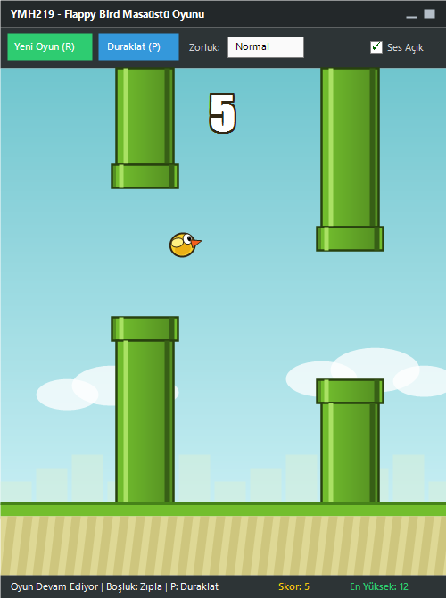
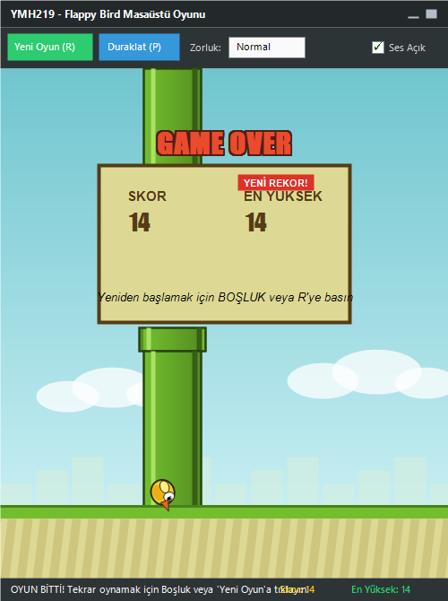
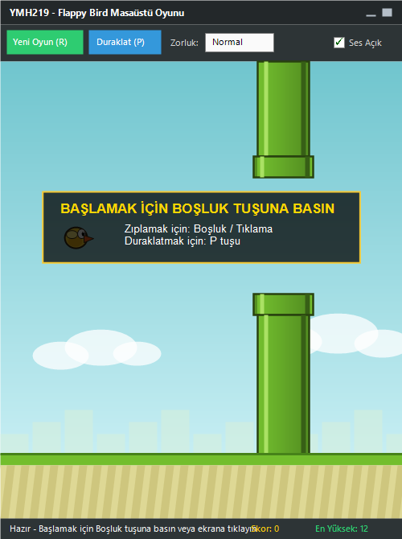

# YMH219 - Flappy Bird Masaüstü Oyunu

Bu proje, **Nesne Tabanlı Programlama (YMH 219)** dersi kapsamında geliştirilmiş, Windows Forms ve C# tabanlı bir Flappy Bird masaüstü oyunudur. Oyun; nesne yönelimli programlama (OOP) ilkeleri, zamanlayıcı (Timer) tabanlı oyun döngüsü, fiziksel yerçekimi/zıplama simülasyonu, AABB dikdörtgen çarpışma algoritmaları ve çift arabellekli (double-buffered) özel GDI+ grafik motoru kullanılarak tasarlanmıştır.

---

## 📋 Proje Bilgileri ve Öğrenci Bilgisi

- **Ders:** Nesne Tabanlı Programlama (YMH 219)
- **Ödev Konusu:** Ödev 3 — Flappy Bird Benzeri Masaüstü Oyunu
- **Geliştirici / Öğrenci:** `agumusfu` ([Öğrenci Adı Soyadı Buraya Giriniz])
- **Öğrenci Numarası:** [Öğrenci Numarası Buraya Giriniz]
- **Platform / Çatı:** .NET 8.0 Windows Desktop (C# 12)
- **Arayüz Teknolojisi:** Windows Forms (WinForms)

---

## 📸 Ekran Görüntüleri

### 1. Oyun İçi Oynanış (Gameplay)
Aşağıda kuşun borular arasından süzülürken canlı skor ve zemin animasyonuyla akışı gösterilmektedir:



### 2. Oyun Bitti ve Yüksek Skor Ekranı (Game Over)
Çarpışma gerçekleştiğinde oyun durur, anlık skor ve yerel diskten yüklenen rekor skor kullanıcıya gösterilir:



### 3. Başlangıç / Hazır Durumu (Start Screen)
Oyun açıldığında veya yeniden başlatıldığında oyuncuyu karşılayan yönerge ekranı:



---

## 🚀 Uygulamanın Temel Özellikleri

### Asgari Gereksinimler
- **Kuş Hareketi ve Fizik:** Kuş, `Boşluk (Space)` veya `Yukarı Yön Tuşu (Up Arrow)` ile yukarı doğru zıplar; yerçekimi ivmesi (`Gravity`) etkisiyle gerçekçi bir düşüş sergiler ve düşüş hızına bağlı olarak burnunu aşağı/yukarı eğer.
- **Döngüsel Engeller (Boru Çiftleri):** Ekranda sağdan sola kayan en az 3 adet boru çifti bulunur. Ekranın solundan tamamen çıkan borular, rastgele boşluk yükseklikleri hesaplanarak sıranın en sağına dinamik olarak yeniden konumlandırılır.
- **Çarpışma Tespiti (Collision Detection):** Kuşun sınır kutusu (`RectangleF Bounds`), boruların üst/alt sınırları veya zemin ile kesiştiğinde (`IntersectsWith`) oyun durur ve Game Over durumuna geçer.
- **Skor Sistemi:** Kuş bir boru çiftini başarıyla geride bıraktığında skor 1 puan artar ve sesli bildirim verilir.
- **Yeni Oyun / Yeniden Başlat:** `Yeni Oyun` butonu, klavyeden `R` tuşu veya Game Over sonrasında `Boşluk` tuşu ile oyun anında sıfırlanabilir.
- **Nesne Yönelimli Mimari:** Kuş, Boru, Oyun Motoru, Skor ve Ses işlevleri birbirinden bağımsız sınıflarla yönetilmektedir.

### İsteğe Bağlı Ek Geliştirmeler (Bonus Özellikler)
- 💾 **Yerel Dosyada Skor Saklama (JSON):** En yüksek rekor skor ve tarih bilgisi `ScoreManager` sınıfı aracılığıyla yerel kullanıcı dizininde (`highscore.json`) otomatik olarak saklanır.
- ⚡ **Dinamik Hız Artışı:** Skor arttıkça boruların ve zeminin kayma hızı kademeli olarak artarak oyunun zorluk seviyesini dinamikleştirir.
- 🎚️ **Zorluk Seviyesi Seçimi:** Kullanıcı arayüzdeki açılır menüden `Kolay`, `Normal` ve `Zor` seviyeleri arasında seçim yapabilir; boru aralığı ve hızı otomatik ayarlanır.
- 🔊 **Prosedürel 8-Bit Retro Ses Efektleri:** Harici hiçbir `.wav` dosyasına bağımlı kalmadan, C# belleğinde anlık PCM ses dalgası sentezleyen `SoundManager` ile zıplama, skor ve çarpışma sesleri çalınır (Aç/Kapat desteklidir).
- 🎨 **Anti-Flicker Double-Buffered GDI+:** Görseller piksel bazlı vektörel GDI+ ile çizilmiştir; harici resim yolu hataları yaşanmaz ve ekran titremesi tamamen engellenmiştir.

---

## 🛠️ Kullanılan Teknolojiler ve Mimarî Yapı

- **Programlama Dili:** C# (.NET 8.0-windows)
- **Grafik ve Çizim:** `System.Drawing`, `System.Drawing.Drawing2D` (GDI+)
- **Ses Yönetimi:** `System.Media.SoundPlayer` (Bellek içi RIFF/WAVE sentezi)
- **Serileştirme:** `System.Text.Json` (Yüksek skor dosya kaydı)
- **Harici Paket İhtiyacı:** Bulunmamaktadır (Sıfır bağımlılık; standart .NET SDK kütüphaneleriyle derlenir).

### Sınıf Mimarisi (OOP Tasarımı)

```
src/FlappyBird/
├── Models/
│   ├── Bird.cs             # Kuş nesnesi: Konum, düşey hız, yerçekimi, zıplama ve çizim
│   ├── PipePair.cs         # Engel çifti: Üst/alt boru geometrisi, çarpışma kutuları ve çizim
│   ├── GameState.cs        # Oyun durumları enum (Ready, Playing, Paused, GameOver)
│   └── DifficultyLevel.cs  # Zorluk seviyeleri ve parametre yapılandırmaları
├── Managers/
│   ├── ScoreManager.cs     # Anlık ve rekor skoru yönetir; JSON dosya I/O işlemlerini yürütür
│   └── SoundManager.cs     # Bellek içi 8-bit ses sentezi ve oynatımı
├── Engine/
│   └── GameEngine.cs       # Oyun döngüsü koordinatörü, fizik, boru geri dönüşümü ve olaylar
├── MainForm.cs             # Windows Forms form kontrolü, klavye dinleyicileri ve olay bağlayıcı
├── MainForm.Designer.cs    # Arayüz bileşen tanımlamaları
└── Program.cs              # Uygulama başlangıç noktası
```

---

## 🎮 Kontroller ve Kısayollar

| Tuş / Eylem | İşlev |
| :--- | :--- |
| **Boşluk (Space)** | Kuşu yukarı doğru zıplatır / Başlatır / Yeniden Başlatır |
| **Yukarı Yön Tuşu (↑)** | Kuşu yukarı doğru zıplatır |
| **Sol Fare Tıklaması** | Ekrana tıklayarak zıplama |
| **P Tuşu** | Oyunu duraklatır / Devam ettirir |
| **R Tuşu** | Oyunu baştan başlatır (Restart) |
| **M Tuşu** | Sesi açar veya kapatır (Mute / Unmute) |

---

## ⚙️ Kurulum ve Çalıştırma Adımları

### Gereksinimler
- [.NET 8.0 SDK](https://dotnet.microsoft.com/download/dotnet/8.0) veya üzeri
- Visual Studio 2022 (v17.0+) veya Visual Studio Code (.NET eklentili)
- Windows 10 / Windows 11 işletim sistemi

### Adım 1: Depoyu Klonlayın
```bash
git clone https://github.com/[KULLANICI_ADINIZ]/YMH219-FlappyBird.git
cd YMH219-FlappyBird
```

### Adım 2: Çözümü Visual Studio ile Açma
- `YMH219-FlappyBird.sln` dosyasına çift tıklayarak projeyi Visual Studio'da açın.
- Üst menüden `Debug` veya `Release` profilini seçip `F5` tuşuna basarak çalıştırın.

### Adım 3: Terminal (.NET CLI) ile Çalıştırma
Alternatif olarak komut satırından derleyip çalıştırabilirsiniz:
```bash
dotnet build
dotnet run --project src/FlappyBird/FlappyBird.csproj
```

---

## ⚠️ Bilinen Sınırlamalar ve Geliştirme Notları

1. **İşletim Sistemi Bağımlılığı:** Proje Windows Forms (WinForms) kullandığından ötürü yalnızca Windows işletim sistemlerinde çalışacak şekilde hedeflenmiştir (`net8.0-windows`).
2. **Yüksek DPI Ölçekleme:** `ApplicationConfiguration.Initialize()` kullanılarak yüksek çözünürlüklü (4K / 2K) ekranlarda arayüz ölçekleme bozulmaları engellenmiştir.
3. **Dosya İzinleri:** Yüksek skor dosyası kullanıcının `AppData\Local\YMH219_FlappyBird` dizininde saklanır. Bu dizine erişilemezse uygulama çalışma dizinine yedekler, hata fırlatıp kapanmaz.
4. **Gelecek Geliştirmeler:** İlerleyen sürümlerde kuş kostüm seçenekleri, çevrimiçi liderlik tablosu ve çoklu engel temaları (gece/gündüz modu) eklenebilir.
